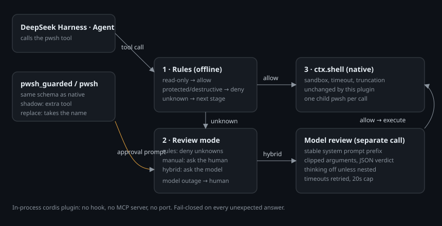

# dsh-customs-guard

给 DSH 原生 `pwsh` 工具加一道执行前审核；**不用 hook、不用 MCP、不起端口**。



- `shadow`（默认）：注册 `pwsh_guarded`，原生 `pwsh` 不受影响，用来试跑。
- `replace`：叠加 `patches/replace.patch.yml` 后禁用 `tool-pwsh`、注册同名 `pwsh`。

设置里会多一个 **自动审核** 页（与「模型」并列）：审核模式（仅规则 / 人工确认 / 模型复核）、提供商（DeepSeek 官方 / opencode-go / 自定义预设）、API 地址、模型、密钥（只写，带连通性测试）、超时、共享缓存前缀。

- 审核模式**切换即生效**，不用保存、不用重启；
- API 配置走草稿 + 「保存 API 配置」，密钥不再回显（已有则显示 `*****`）；
- 只读命令直接放行；规则判死的直接拒绝；只有规则识别不了的才进人工或模型；
- 模型不可用时按 1/2/4/8/16 秒重试，单次等待上限 20 秒；仍失败则（主会话）转人工兜底。

## 判定顺序与「语法完整性」

审核按固定顺序执行，前面的结论不会被后面的推翻：

```
1. 语法/操作数完整性   → MALFORMED_COMMAND（硬拒，不可上诉）
2. 硬危险清单          → DESTRUCTIVE_ROOT / PROTECTED_PATH / DISK_OPERATION /
                         SYSTEM_MODIFICATION / ENCODED_COMMAND（硬拒）
3. 规则可判            → 只读放行；破坏性写入/删除送模型核对 intention
4. 规则判不了          → 模型复核（hybrid）或人工确认（manual）
```

**第 1 步是刻意放在最前面的**：一条连操作数都不全的命令，后面的路径分析、范围判断都建立在错误前提上。

`MALFORMED_COMMAND` 覆盖这些形态：

| 形态 | 例子 |
| --- | --- |
| 引号 / 括号不闭合 | `Remove-Item "unclosed` |
| 悬挂的操作符 | `Get-ChildItem \|`、`Get-ChildItem &&` |
| 破坏性动词缺目标 | `Remove-Item -Recurse -Force`、`rm -rf`、`Move-Item` |
| 标志位缺值 | `Copy-Item -Path` |
| 值被误当目标 | `Set-Content -Value hi`（有 `-Value` 却无 `-Path`） |

**为什么不做成"交给 shell 报错"**：如果命令本身语法不完整，它的实际效果取决于解释器的错误恢复策略，而我们无法静态建模那套策略。真实遇到过的形态是"参数漏填但命令仍被执行"——没有报错，直接产生了预期外的副作用。

同样的判断也写进了审核模型的系统提示词：**不完整命令按不安全处理，不许推理"它大概会报错所以没事"**；如果所述目的需要命令当前不具备的参数，一律 deny。

## 被拒绝时怎么继续：`escalate` 与 `authority`

自动审核只看命令本身，**不认"用户之前说过可以"**——这是有意的：模型可以复述、甚至编造用户的授权，把它当作证据等于给审核开后门。

所以提供两条互补的东西：

| 参数 | 作用 | 边界 |
| --- | --- | --- |
| `escalate: true` | 自动审核拒绝时，把这一次调用**转给真人**确认（一次） | 硬拒绝清单（删盘/受保护路径/磁盘/注册表/编码命令/语法不完整）**不生效**；委派会话没有真人，仍然拒绝 |
| `authority: "用户：…"` | 引用用户原话，附在给真人的提示里作为上下文 | **不是证据**。审核模型不会因为它放行，它只影响人看到的说明 |

真人的弹窗里会同时看到：命令、目录、规则判定、模型拒绝理由、以及 `authority` 引用。人点「允许一次」才执行。

为什么不做"引用历史会话即可自动放行"：审核器无法校验引用的真实性（它看不到完整会话、也无法区分引用与伪造）。**只有人的一次点击是可验证的授权**，其他都是可被模型生成的内容。

## 它怎么工作

```
tool call → 本地规则审核（零依赖，纯函数）
              ├─ 拒绝 → 抛 CUSTOMS_DENIED，命令不执行
              └─ 放行 → ctx.shell.resolve/execute（沙箱、超时、截断全部原生）
```

## 安装（shadow）

普通 PowerShell（非沙箱）里，把路径换成你本机的仓库位置：

```powershell
powershell -ExecutionPolicy Bypass -File "<仓库目录>\Plugs\install.ps1"
```

例如仓库克隆在 `%USERPROFILE%\dsh-customs-guard`，就写：

```powershell
powershell -ExecutionPolicy Bypass -File "$env:USERPROFILE\dsh-customs-guard\Plugs\install.ps1"
```

然后完全退出并重启 DSH。

## 切换为替换

把 `patches/replace.patch.yml` 的 `mode` 改成 `replace`（或直接在 profile 里把插件配置设为 `mode: replace`），重启 DSH。

替换为什么有效、以及为什么不能用 `disabled` 停用原生工具：

- DSH 的工具可见性分三层：**agent 自身作用域 > 预设（preset）祖先前置作用域 > 全局（插件根）**。
- Web 版的原生 `pwsh` 声明在 `dsh-web-app/presets/standard.patch.yml` 的 `preset-standard.config.plugins` 里，落在 **preset 层**。
- 插件如果在根上下文注册同名工具，只会落进 **全局层**——被 preset 层遮蔽，表现为"注册成功但模型仍看到原生工具"。
- 因此本插件监听 `agent/created`，用 `agent.ctx.inject(['tools'], s => s.tools.register(...))` 把工具注册进**每个 agent 自己的作用域**，从而遮蔽 preset 的原生实现。
- 顺带说明：在 profile 补丁里写 `- id: tool-pwsh / disabled: true` **无效**。Web 版协议层早已把 host 那一行设为 `disabled`，真正生效的是 preset 内嵌的那一条，顶层 id 改不到。

## 回滚

把 `mode` 改回 `shadow`，重启 DSH；原生 `pwsh` 恢复为默认工具，受审版本只以 `pwsh_guarded` 出现。

详细步骤、验收与排障见上级目录的 `手册.md`。
